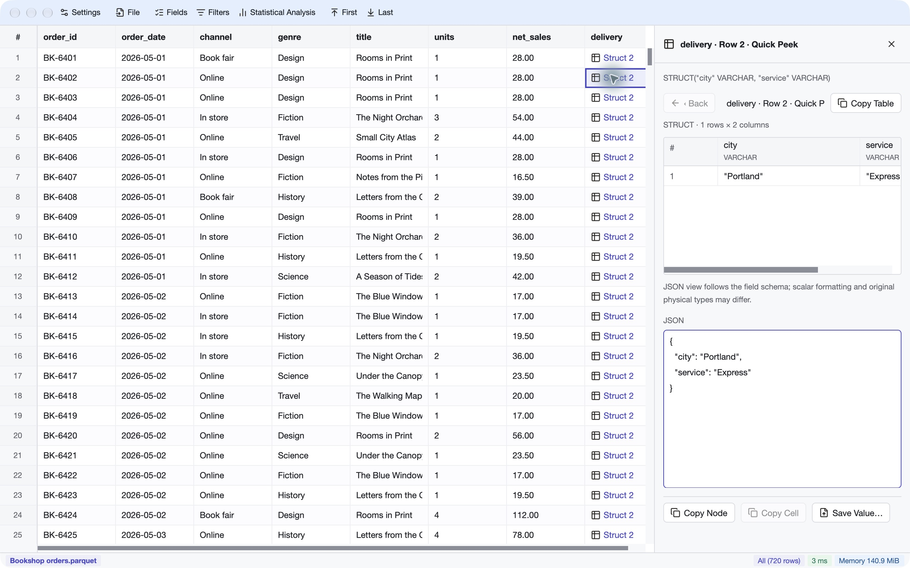
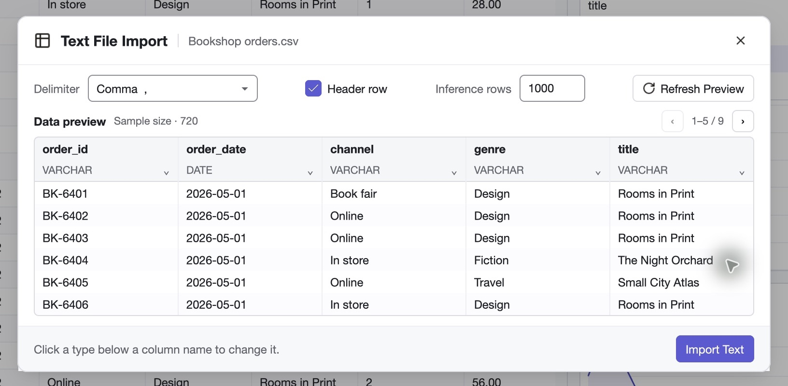

# ParquetViewer


ParquetViewer is a native and embarassingly fast macOS app for browsing, filtering, and analyzing Parquet, CSV, and TSV files, powered by Rust Arrow, DataFusion, and GPUI. 



## Features
- **Fast and Memory Efficient**  Powered by Rust Arrow and DataFusion, it sufficiently utilize the memory and CPU resources, supporting the check of big datasets.
- **Browse large text files.** Open a CSV or TSV to read the first rows while the footer tracks indexing progress. Scroll through available rows or choose **File → Go to Row…** to jump as soon as a row becomes available.
- **Navigate large tables.** Load a row range, choose which fields to display, freeze rows or columns, and sort by multiple fields. For large text files, you can cancel a range load and reuse the row index for later jumps. Save a view and restore it when you reopen the same file.
- **Filter records.** Combine conditions across the loaded range or the whole file. Filters can inspect fields inside a Struct and values inside a List. Source row numbers stay attached to matching records.
- **Inspect individual cells.** Open a nested Parquet value in Quick Peek to explore its structure or copy its JSON. The sidebar also previews image and audio data.
- **Analyze and export.** Check missing values, percentiles, and category counts. Group records, chart summaries, and drill into the rows behind a group. Export the current table or its summary to CSV, JSON, Excel, or Parquet.

## Install

On Apple Silicon, download the DMG, open it, and drag **Parquet Viewer** into **Applications**. The app is ad hoc signed and has no Apple notarization. [Download the latest DMG](https://github.com/xuestrange/ParquetViewer/releases/latest/download/Parquet-Viewer-macOS-arm64.dmg)

## Quick start

1. **Open a file.** Drop it on the welcome screen or press `⌘O`. CSV, TSV, TAB, TXT, and PSV files open with automatically detected settings. You can browse the indexed rows while the footer shows progress. Hover over the percentage to see how many rows and bytes have been indexed.
2. **Adjust text import settings when needed.** Choose **File → Import Text File…** for a preview or a file with an unfamiliar extension. Check the delimiter and header, click the type below a column name to change it, then choose **Import Text**. Press `⌘R` to revisit those settings for an open text file.

   

3. **Browse and filter.** Choose **File → Load Range…** to work with a particular set of rows or **File → Load All Records** for the whole table. **File → Browse Text File** returns to browsing with the existing index. Use **Fields** to choose columns. In **Filters**, choose **Entire file**, click **Add condition**, and select a text field. Choose **Contains**, enter the text, and click **Apply** to show matching rows. Press `⇧⌘V` to save or restore a view.
4. **Analyze and export.** Open **Statistical Analysis** and select a column. In the example below, the median net sale across 720 orders is 24.50. Switch to **Aggregation** to see grouped results. Press `⌘S` to export the current table, or export a summary from the aggregation sidebar.

   

## Build from source

The app uses Rust and GPUI for the interface and Apache Arrow and DataFusion for data processing. Building requires macOS, Rust 1.88 or later, and Xcode Command Line Tools. Run these commands from the project root.

| Task | Command |
| --- | --- |
| Launch the app | `cargo run --locked` |
| Run the tests | `cargo test --locked` |
| Build the app and DMG | `scripts/bundle-macos.sh --dmg` |

The packaging script writes the app and DMG to `dist/`.

## Publish a release

Push a new Git tag to start the release workflow. GitHub Actions builds the tagged source on an Apple Silicon Mac, checks the signed app inside the DMG, and attaches the image to the GitHub Release.

```sh
git tag -a v0.2.0 -m "Release v0.2.0"
git push origin v0.2.0
```

A tag such as `v0.2.0` sets the app version to `0.2.0`. A tag such as `v0.2.0-beta.1` publishes a GitHub prerelease with the same numeric app version. Other tag names use the version in the app’s Info.plist.
