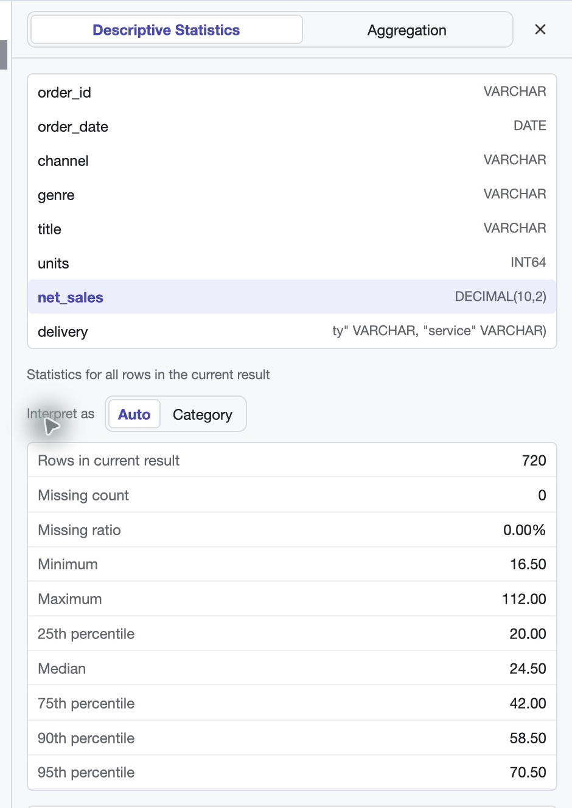

# Parquet Viewer for macOS

Parquet Viewer is a native macOS app for browsing, filtering, and analyzing Parquet, CSV, and TSV files. You can open files in separate windows. Source files stay read-only. The interface supports English and Simplified Chinese, with light, dark, and system appearance.

## Features

- **Preview text imports.** Check the delimiter, header, and inferred column types before opening a CSV or TSV. Set an identifier to **Text** to keep its leading zeros.
- **Navigate large tables.** Load a row range, choose which fields to display, freeze rows or columns, and sort by multiple fields. For large text files, you can cancel a range load and reuse the row index for later jumps. Save a view and restore it when you reopen the same file.
- **Find and filter records.** Search the current result or combine filter conditions across the loaded range or the whole file. Filters can inspect fields inside a Struct and values inside a List. Source row numbers stay attached to matching records.
- **Inspect individual cells.** Open a nested Parquet value in Quick Peek to explore its structure or copy its JSON. The sidebar also previews image and audio data.
- **Analyze and export.** Check missing values, percentiles, and category counts. Group records, chart summaries, and drill into the rows behind a group. Export the current table or its summary to CSV, JSON, Excel, or Parquet.

## Install

On Apple Silicon, open `Parquet-Viewer-macOS-arm64.dmg` and drag **Parquet Viewer** into **Applications**. The default build is ad hoc signed and has no Apple notarization. To create the disk image on your Mac, follow the [build instructions](#build-from-source).

## Quick start

1. **Open a file.** Drop it on the welcome screen or press `⌘O`. To import delimited text with another extension, choose **File → Import Text File…**.
2. **Check the text preview.** For CSV and TSV files, click the type below a column name to change it, then choose **Import Text**. Press `⌘R` to revisit the import settings.

   

3. **Browse and filter.** Use **Fields** to choose columns and **Filters** to narrow the rows. Press `⇧⌘F` to find a value, `⌘G` for the next match, and `⇧⌘V` to save or restore a view.
4. **Analyze and export.** Open **Statistical Analysis** and select a column. In the example below, the median net sale across 720 orders is 24.50. Switch to **Aggregation** to see grouped results. Press `⌘S` to export the current table, or export a summary from the aggregation sidebar.

   

## Build from source

The app uses Rust and GPUI for the interface and Apache Arrow and DataFusion for data processing. Building requires macOS, Rust 1.88 or later, and Xcode Command Line Tools. Run these commands from the project root.

| Task | Command |
| --- | --- |
| Launch the app | `cargo run --locked` |
| Run the tests | `cargo test --locked` |
| Build the app and DMG | `scripts/bundle-macos.sh --dmg` |

The packaging script writes the app and DMG to `dist/`.
